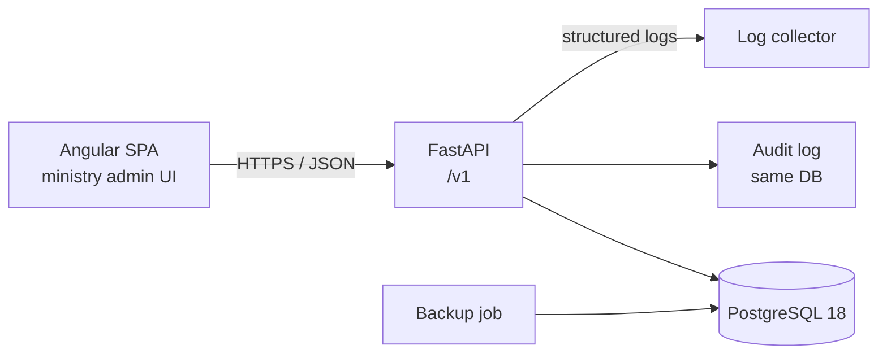
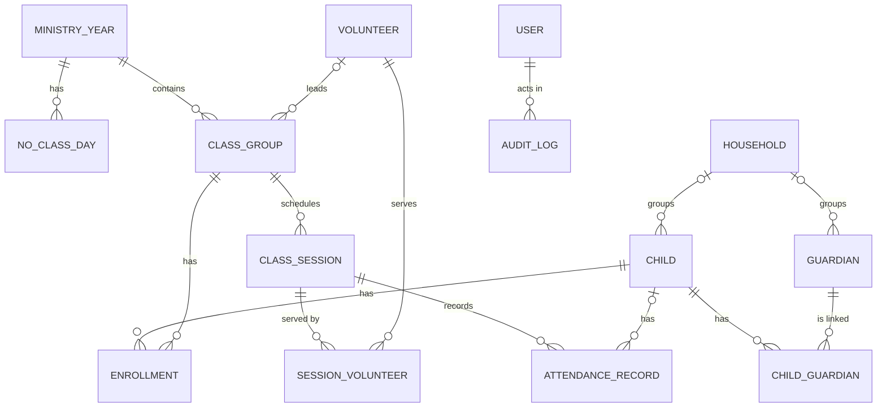

# Children's Bible Study Group — Technical Design

- **Status:** Accepted — church design
- **Version:** 2.0
- **Date:** 2026-11-19
- **Requirements:** [01-requirements.md](01-requirements.md)

> **Implementation note:** the code now implements this model, the audit trail, and the
> hardening baseline. Seed/demo data and deployment remain.

## 1. Architecture



Single deployable backend, single database, SPA frontend. No background workers in the
MVP; all work is request-scoped. The API is stateless (JWT), so it can scale horizontally
behind a proxy.

### Runtime

| Environment | Backend | Frontend | Database |
| --- | --- | --- | --- |
| Local | `uvicorn --reload` on `:8000` | `ng serve` on `:4200` | Docker Postgres on `:5433` |
| CI | pytest + ruff + mypy | `ng build`, `ng test` | Postgres service container |
| Production | Uvicorn workers in container | Static build served by nginx/CDN | Managed Postgres |

## 2. Repository layout

```text
.
├── backend/
│   ├── alembic/                 # migrations
│   ├── src/schoolops/           # package name retained until the refactor
│   │   ├── main.py              # app = create_app()
│   │   ├── factory.py           # app factory + lifespan
│   │   ├── core/                # settings, errors, security
│   │   ├── db/                  # base, session, models/
│   │   ├── api/                 # deps + v1 routers
│   │   └── domain/              # pure business rules
│   └── tests/
├── frontend/                    # Angular app
├── docs/                        # requirements, design, ADRs
├── docker-compose.yml
├── justfile
└── README.md
```

Backend features live in `api/v1/<feature>/` (router, schemas, service). Domain rules that
do not need HTTP or SQLAlchemy live in `domain/`. Routers stay thin: parse → one service
call → serialize.

## 3. Data model

### 3.1 Entity-relationship diagram



> `CLASS_GROUP` is the diagram-safe name for the `classes` table; `CLASS` is a reserved
> word in Mermaid's ER parser. Check-in/check-out is deliberately absent from the MVP.

### 3.2 Entities

All tables use UUID primary keys, `created_at`/`updated_at` timestamps (UTC), and named
constraints via a metadata naming convention so Alembic diffs are stable.

| Entity | Key fields | Constraints / notes |
| --- | --- | --- |
| `ministry_years` | label, start_date, end_date, meeting_weekdays, is_active | label unique; start < end; partial unique index for one active year; `meeting_weekdays` stores ISO weekday numbers and defaults to `{7}` (Sunday) |
| `no_class_days` | ministry_year_id, date, name, kind | unique (ministry_year_id, date); date inside year |
| `volunteers` | first_name, last_name, phone, email, joined_on, status | phone required; email nullable but unique when present; all volunteers, no compliance data |
| `households` | name, address, notes | name optional; groups siblings and shared address |
| `guardians` | household_id (nullable), first_name, last_name, phone, email, notes | phone required; email optional; may link to children in any household |
| `children` | household_id (nullable), first_name, last_name, date_of_birth, grade, allergies, medical_notes, photo_consent, status, joined_on, notes | no admission number; DOB required; status enum active/inactive/visitor/left; no hard delete |
| `child_guardians` | child_id, guardian_id, relationship, is_primary, is_emergency | unique (child_id, guardian_id); one primary per child (partial unique index) |
| `classes` | ministry_year_id, name, age_band, age_min, age_max, lead_volunteer_id, room, capacity, curriculum | unique (ministry_year_id, name); age_min <= age_max; capacity informational |
| `enrollments` | child_id, class_id, start_date, end_date | unique open (child_id, class_id); end >= start; service rejects more than one active class per child per year |
| `class_sessions` | class_id, date, start_time, end_time, topic, notes, content_markdown, resources (JSONB label/URL) | unique (class_id, date, start_time); date is a meeting day |
| `session_volunteers` | class_session_id, volunteer_id | unique (class_session_id, volunteer_id); any active volunteer |
| `attendance_records` | class_session_id, child_id (nullable), visitor_name (nullable), status, note, recorded_by | exactly one of child_id/visitor_name; one enrolled record per (session, child); status present/absent |
| `users` | email, password_hash, role, is_active, last_login_at | email unique; roles admin/leader/parent; only admin enabled |
| `audit_logs` | actor_user_id, action, entity_type, entity_id, changes (JSONB), created_at | append-only; no updates/deletes |

> Class-level content is the single `classes.curriculum` field. Lesson content and
> resources live on `class_sessions`; there is no separate content table.

### 3.3 Invariants and how they are enforced

| Invariant | Database | Service |
| --- | --- | --- |
| One active ministry year | partial unique index on `is_active` where true | transaction deactivates others first |
| Session on a meeting day | none (calendar is data) | `CalendarService.is_meeting_day(year, date)` before insert/update |
| Attendance only for enrolled child or named visitor | check exactly one of `child_id`/`visitor_name`; FK | load enrollment active on session date; visitors are name-only |
| No duplicate enrolled attendance | unique partial index on (session, child) | `ON CONFLICT` upsert |
| One primary guardian | partial unique index on `child_guardians(child_id)` where primary | set-primary operation in transaction |
| One active class per child per year | service rule | reject a second active enrollment in the same ministry year |
| Class age range valid | check `age_min <= age_max` when both present | schema/service validation |

**Why per-session attendance:** it supports class-level and child-level reporting, weekly
rosters, and lesson content, while a daily figure is a cheap aggregation. See ADR-0002.

## 4. API conventions

- Base path `/v1`; health endpoints at `/health/live` and `/health/ready`.
- JSON only; dates `YYYY-MM-DD`, times `HH:MM:SS`, timestamps ISO-8601 UTC.
- Resource names plural and kebab-case (`/ministry-years`, `/class-sessions`).
- Errors use RFC 9457 Problem Details (`application/problem+json`).
- Validation errors return `422` with an `errors` array of field-level messages.
- Pagination: `?limit=50&offset=0` (limit 1–100), response
  `{ "items": [...], "total": 123, "limit": 50, "offset": 0 }`.
- Filtering/sorting: explicit query params per endpoint; no generic query language.
- `PATCH` uses `exclude_unset` so absent ≠ null.
- Create returns `201` + `Location`; delete returns `204`.
- `DELETE` preserves history where the domain requires it: a volunteer is deactivated and
  an enrollment is ended. A class with enrollment or session history is protected.
- Child responses include a derived `guardian_count`. Activating a child without a guardian
  is allowed but returns `X-CBSG-Warning`; the UI also marks such children.

### 4.1 Endpoint map (MVP)

| Area | Endpoints |
| --- | --- |
| Auth | `POST /v1/auth/login` (public), `GET /v1/auth/me` (protected) |
| Years | `GET/POST /v1/ministry-years`, `GET/PATCH /v1/ministry-years/{id}`, `POST /v1/ministry-years/{id}/activate` |
| Calendar | `GET/POST /v1/ministry-years/{id}/no-class-days`, `DELETE /v1/no-class-days/{id}`, `GET /v1/ministry-years/{id}/meeting-days?from=&to=` |
| Volunteers | `GET/POST /v1/volunteers`, `GET/PATCH/DELETE /v1/volunteers/{id}` |
| Households | `GET/POST /v1/households`, `GET/PATCH /v1/households/{id}` |
| Guardians | `GET/POST /v1/guardians`, `GET/PATCH/DELETE /v1/guardians/{id}` |
| Child links | `GET/POST /v1/children/{id}/guardians`, `PATCH/DELETE /v1/child-guardians/{id}`, `POST /v1/child-guardians/{id}/set-primary` |
| Children | `GET/POST /v1/children`, `GET/PATCH /v1/children/{id}`, `GET /v1/children/{id}/attendance` |
| Classes | `GET/POST /v1/classes`, `GET/PATCH/DELETE /v1/classes/{id}`, `GET/POST /v1/classes/{id}/enrollments`, `GET/POST /v1/classes/{id}/sessions`, `POST /v1/classes/{id}/sessions/generate` |
| Enrollments | `PATCH/DELETE /v1/enrollments/{id}` |
| Promotion | `POST /v1/promotions/preview`, `POST /v1/promotions/apply` |
| Sessions | `GET/PATCH/DELETE /v1/class-sessions/{id}`, `GET/PUT /v1/class-sessions/{id}/attendance`, `GET/PUT /v1/class-sessions/{id}/volunteers` |
| Reports | `GET /v1/reports/attendance`, `GET /v1/reports/attendance.csv`, `GET /v1/reports/not-seen`, `GET /v1/reports/dashboard` |
| Audit | `GET /v1/audit-logs?entity_type=&entity_id=&from=&to=` |

Full request/response schemas live in the generated OpenAPI document at `/docs` (local
only) and are the source of truth for the Angular client.

## 5. Authentication and authorization

- Roles `admin`, `leader`, `parent` exist from day one; only `admin` is granted access in
  the MVP.
- `POST /v1/auth/login` accepts JSON `{email, password}` over TLS and returns
  `{access_token, token_type: "bearer", expires_in}`. The token is an HS256 JWT (8 h) with
  `sub`, `role`, `iat`, `exp`.
- Passwords are hashed with **Argon2id** (`pwdlib[argon2]`); hashes never leave the DB.
- The only public `/v1` route is login. Every other route depends on `get_current_admin`,
  which validates signature, expiry, active user, and admin role. Missing, invalid,
  expired, or inactive-user tokens return `401` with `WWW-Authenticate: Bearer`; a valid
  non-admin token returns `403`.
- Login is rate-limited to 5 failures per IP + email in a rolling 15-minute window
  (in-process for the MVP) and returns `429` with `Retry-After`.
- Token is stored in Angular **memory** (not `localStorage`); on refresh the user logs in
  again. Phase 2 adds a rotating refresh token in an `HttpOnly`, `Secure`,
  `SameSite=Strict` cookie.
- The first admin is created with
  `python -m schoolops.cli create-admin --email ...` (or `just admin <email>`).
- See ADR-0003.

## 6. Meeting-day and attendance rules

**Meeting-day query** for a year and date range:

```sql
SELECT d::date
FROM generate_series(:from, :to, interval '1 day') AS d
WHERE EXTRACT(ISODOW FROM d) = ANY(:meeting_weekdays)
  AND NOT EXISTS (
    SELECT 1 FROM no_class_days n
    WHERE n.ministry_year_id = :year_id AND n.date = d::date
  )
ORDER BY d;
```

- Year boundaries are inclusive.
- This deployment's meeting week is **Sunday only** (`EXTRACT(ISODOW)` = 7). The value is
  stored per ministry year, so it can change without a code change.
- Each class has its own sessions. A class may have several sessions on the same Sunday
  when the church runs multiple services.
- The active year is the default context for new classes and reports; historical years
  remain editable for corrections.
- Bulk session generation takes a weekday pattern, start/end time, and date range, then
  inserts only meeting days not already having a session at that start time.

**Attendance:**

```text
rate = count(present) / count(recorded)
```

- `present` and `absent` are the only child statuses; a missing record is `not recorded`
  and never counted as absence.
- Visitor entries are recorded by name, appear in the session's visitor count, and are
  excluded from enrolled-child rates.
- Session volunteer participation is separate from child attendance; it is a list, not a
  present/absent status.
- The session roster response includes allergies, medical notes, photo consent, and
  guardian contact details for the children active on that date.

## 7. Promotion workflow

Classes are recreated per ministry year. Promotion is a reviewed mapping rather than an
age-based automatic assignment, because several classes may serve the same age band.

**Preview** — `POST /v1/promotions/preview`:

```json
{
  "source_year_id": "…",
  "target_year_id": "…",
  "mappings": [
    { "source_class_id": "…", "target_class_id": "…" }
  ]
}
```

The response returns:
- `assignments`: child → source class → target class, with each child's age at the target
  year start and the target age band for review
- `unmatched`: children active in the source year whose source class has no mapping, plus
  children with no active source enrollment
- `already_enrolled`: children who already have an active target-year class
- counts for each group

**Apply** — `POST /v1/promotions/apply` with the same body:
- Creates target-year enrollments starting on the target year's start date.
- Skips children already actively enrolled in the target year.
- Is idempotent: re-applying the same mapping creates no duplicates.
- Returns `created` and `skipped` ids.
- Unmatched children remain on the source rosters and can be enrolled manually.

The mapping UI shows source and target class age bands side by side so the administrator can
spot incorrect promotions before applying.

## 8. Dashboard, reports, and CSV

**Dashboard** (`GET /v1/reports/dashboard`) returns:
- active ministry year (or `null`)
- active children, active volunteers, and classes in the active year
- today's sessions with class names and times
- attendance records written today
- children not seen in the last 30 days

**Not-seen report** (`GET /v1/reports/not-seen?since=&class_id=`):
- active children with no `present` record on or after `since`
- last present date (or `null`)
- number of sessions in the period where the child was enrolled but not marked present
- class filter optional

**CSV export** (`GET /v1/reports/attendance.csv`):
- same filters as the attendance report
- one row per child with present, absent, not recorded, recorded, rate, and last present
  date
- generated server-side with the standard `csv` writer so names containing commas are
  quoted

## 9. Testing strategy

| Layer | Tool | Focus |
| --- | --- | --- |
| Domain unit | pytest | meeting-day math, attendance rate, age/promotion helpers, validators |
| API integration | pytest + httpx + Postgres | status codes, constraints, auth, pagination, Problem Details, transaction rollback |
| Frontend unit | Vitest + Angular TestBed | services, guards, form validation, signal state |
| E2E | Playwright | login → year → household → child → class → enroll → session → attendance → report → promote |
| Contract | OpenAPI diff in CI | detect breaking API changes |

- Tests use a real PostgreSQL database and run migrations; no SQLite (array/partial-index
  behaviour differs).
- Each test runs in a transaction rolled back at teardown, or a per-worker database.
- No test hits the network. Time is injected through a `Clock` dependency for calendar
  tests.

## 10. Deployment and operations

- Multi-stage Dockerfiles for API (uv → slim runtime) and frontend (Node build → nginx).
- `docker compose` for local; production targets a managed Postgres with automated
  backups and PITR.
- Migrations run as a release step (`alembic upgrade head`) before new API containers
  receive traffic; rollback = previous image + documented down migration.
- The first administrator is created once per environment with
  `python -m schoolops.cli create-admin --email ...`; no public registration exists.
- `/health/live` = process alive; `/health/ready` = DB reachable. Readiness gates traffic.
- Structured JSON logs (request id, method, path, status, latency); no query strings,
  bodies, or PII. `X-Request-ID` is accepted when well formed or generated per request.
- Hardening baseline: `nosniff`, frame denial, no-referrer, permissions policy, same-origin
  resource policy, `Cache-Control: no-store` for API/health, plus CSP and HSTS in
  production. A 1 MiB request-body limit is configurable via `MAX_REQUEST_BODY_BYTES`.
- Staging/production refuse to start with the development JWT secret, a secret shorter than
  32 characters, debug enabled, or an unsupported JWT algorithm.
- Daily backups, 30-day retention, quarterly restore drill.
- Secrets from environment/secret manager; `.env` is local-only and git-ignored.

## 11. Risks and mitigations

| Risk | Impact | Mitigation |
| --- | --- | --- |
| Sensitive child/medical data exposure | High | Restrict to authenticated admins; no PII in logs; audit trail; least-privilege DB user |
| Check-in/pickup expected but out of scope | Medium | State it explicitly; design attendance so a check-in model can be added later |
| Chunked request bodies can exceed the declared limit | Low | Enforce `Content-Length` at the API edge and add a proxy/server limit at deployment |
| Incorrect annual promotion | Medium | Reviewed source→target mapping, preview, unmatched list, idempotent apply |
| Duplicate households/guardians | Medium | Search by phone/name; allow merging later; household name optional |
| Several classes share an age band | Medium | Manual mapping rather than automatic age assignment |
| Volunteer email optional but logins need email | Low | Admin-only logins in MVP; create accounts only for staff who need access |
| Calendar closures forgotten | Medium | No-class days per year; weekly roster shows the current date |

## 12. Decisions (ADR index)

| ADR | Decision |
| --- | --- |
| [0001](adr/0001-stack-and-monorepo.md) | FastAPI + Angular monorepo with a src-layout backend |
| [0002](adr/0002-attendance-per-session.md) | Attendance is per class session, gated by a ministry calendar |
| [0003](adr/0003-auth.md) | JWT bearer tokens, Argon2id, admin-only MVP with RBAC-ready roles |
| [0004](adr/0004-households-and-guardians.md) | Household grouping with per-child guardian links and one primary guardian |
| [0005](adr/0005-age-band-promotion.md) | Reviewed source→target class mapping for annual promotion |
| [0006](adr/0006-no-check-in-out.md) | Secure check-in/check-out is out of scope for the MVP |
| [0007](adr/0007-audit-trail.md) | Append-only application audit log with actor and before/after values |
