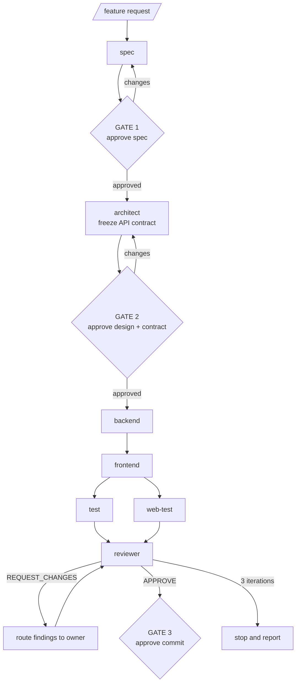

# Agent Workflow — Full-Stack FastAPI + Angular SDLC

- **Status:** Active
- **Version:** 2.0
- **Date:** 2026-11-23

A human-approved pipeline of OpenCode agents for designing and implementing features across
the FastAPI backend and the Angular frontend. The human stays in the loop at three gates;
agents do the work between them.

## Agents

| Agent | Mode | Writes | Purpose |
| --- | --- | --- | --- |
| `orchestrator` | primary | nothing | Decomposes work, delegates, freezes the contract, enforces gates |
| `spec` | subagent | `docs/features/**`, `docs/01-requirements.md` | API + UI acceptance criteria, screens, states |
| `architect` | subagent | `docs/02-design.md`, `docs/adr/**` | Data model, frozen API contract, Angular design |
| `backend` | subagent | `backend/src/**`, `backend/alembic/**` | FastAPI vertical slice |
| `frontend` | subagent | `frontend/src/**` (except `*.spec.ts`) | Angular route, page, models, states |
| `test` | subagent | `backend/tests/**` | pytest from `AC-API-*` |
| `web-test` | subagent | `frontend/src/**/*.spec.ts` | vitest from `AC-UI-*` |
| `reviewer` | subagent | nothing (read-only) | Full-stack findings + `just check` verdict |

Definitions live in `.opencode/agents/`; commands in `.opencode/commands/`.

## Flow



`test` and `web-test` always run in parallel (disjoint file sets). `backend` and
`frontend` run sequentially by default; the orchestrator may parallelize them only when
the contract is frozen **and** the feature is UI over endpoints that already exist.

## Usage

```text
/feature visitor follow-up report           # full-stack (default)
/feature backend-only export CSV report     # API only
/feature frontend-only show allergies list  # UI only, requires an existing endpoint
```

or talk to the `orchestrator` agent directly. Use `/review` at any time for a read-only
full-stack review (`/review` replaces the built-in command of the same name in this project).

Approval gates:

1. **Spec** — scope, screens, API surface, `AC-API-*` / `AC-UI-*`, open questions.
2. **Design** — data model, endpoints, migration plan, Angular routes/components/state,
   and the **frozen API contract** (exact fields, types, nullability, enums).
3. **Delivery** — endpoints, routes, files, migrations, contract drift, resolved findings,
   `just check` result, commit approval.

The orchestrator never commits, merges, pushes, or deletes without gate 3 approval.
After approval it may `git add` and `git commit`; merging, pushing, and destructive git
operations stay manual.

## Contract discipline

`docs/02-design.md` is the single source of truth. The frontend's `core/models.ts` must
match the backend's Pydantic schemas exactly. If the two disagree, the design doc wins and
the offending side is fixed — they never "meet in the middle". A contract change after
gate 2 sends the work back to gate 2 for re-approval.

## Ownership rules

- One writer per area: `backend` never edits tests or `frontend/**`; `frontend` never
  edits `*.spec.ts`, `backend/**`, `package.json`, or tsconfigs; `test` and `web-test`
  never edit production code; `spec`/`architect` never edit code; `reviewer` edits nothing.
- `orchestrator` cannot edit files, so no stage can silently patch around a gate.
- Subagents start with fresh context; the orchestrator passes the spec, the frozen contract,
  design decisions, and artifact paths in every delegation prompt.

## Quality gate

`just check` = backend `ruff format --check` + `ruff check` + `mypy` + `pytest`, plus
`npm run build` + `npm test` for the frontend. It is the final authority for correctness;
the reviewer's verdict adds judgment, but a red gate always blocks.

## Tuning

- Models: no model is pinned; agents inherit the session model. Pin per-agent `model` in
  the frontmatter when you want a cheaper model for `spec`/`test`/`web-test` and a stronger
  one for `architect`/`reviewer`.
- Iteration cap: 3 review loops, then the orchestrator stops and reports the blocker.
- To add a stage (e.g. `security`, `docs`, `e2e`), copy an agent file, restrict its `edit`
  permissions to its artifact directory, add it to the orchestrator prompt and to the
  orchestrator's `subagent` allow-list, and update this page.
